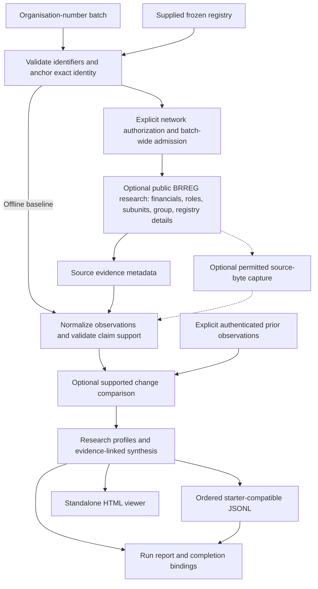

# Signalpost

[100-company standalone sample viewer](release_artifacts/demo-100/viewer.html)
([provenance and reproduction](release_artifacts/demo-100/README.md)): download
the raw HTML and open locally. This is an explicitly **synthetic, zero-network**
baseline demonstration, not current live research or an official evaluation.

**Company research anchored to a Norwegian organisation number, with evidence you can follow.**

Signalpost constructs source-linked company profiles from supported public records, preserving the registered entity, accounting context and changes between authenticated observations.

Company information is scattered across registers, reporting periods and related entities. Combining it carelessly can attach a subsidiary's location to its parent, mistake group accounts for company accounts, or present unchecked information as absent. Signalpost anchors each profile to the exact organisation number, normalizes supported observations and validates them before publishing a reproducible result.

Built for the [Builderr Company Research Challenge](https://builderr.ai/challenges/signalpost), it runs without an LLM or paid model key. The default demonstration is entirely offline; public-source enrichment is a separate, explicitly authorized execution path.

## What it researches

- **Exact registered identity.** Nine-digit organisation-number validation and a supplied frozen registry establish the baseline. Authorized current-data bootstrap requires an exact-number BRREG response before downstream research.
- **Official records, without entity confusion.** Supported enrichment covers registered roles, parent-validated subunits, registry details and explicit corporate relationships. A narrow group lookup is not comprehensive ownership discovery.
- **Financial history with context.** Available annual-account observations retain reporting dates, currency and accounting scope. Consolidated `KONSERN` figures are not published as individual-company `SELSKAP` facts; missing amounts never become zero.
- **Evidence-linked facts.** Claims reference source records with URLs, retrieval metadata and digests. Normalization, attribution checks and publication validation are separate from retrieval.
- **Useful deterministic briefs.** Templates select supported identity, financial, leadership and location facts, with claim references and explicit limitations. Prior-period comparisons require compatible periods, currencies, scopes and units.
- **Review and refresh.** A standalone viewer supports search, side-by-side coverage comparison and source inspection. Explicit authenticated previous observations enable material-change records preserving old and new evidence.

## Run an offline example

Requirements: **Python 3.12** and [uv](https://docs.astral.sh/uv/). In PowerShell:

```powershell
git clone https://github.com/saikiranpulagalla/signalpost.git
Set-Location signalpost
uv sync --locked
```

Run from the repository root, using a fresh `out/sample` directory:

```powershell
uv run --no-sync python -S scripts/run_competition_batch.py `
  --organisations tests/v0/demo/organisations.jsonl `
  --bulk tests/v0/demo/frozen-registry.csv `
  --modules registry,accounting_obligation `
  --network-policy offline `
  --output-target starter_compatible `
  --profiles-output out/sample/profiles.jsonl `
  --output out/sample/envelopes.jsonl `
  --report out/sample/report.json `
  --viewer-output out/sample/viewer.html `
  --run-id sample
```

Open **`out/sample/viewer.html`** in a browser. Inspect **`out/sample/envelopes.jsonl`** for the two ordered terminal results. This example uses **synthetic fixtures**, not real company observations, and starts **zero external company-source requests**. Dependency installation can download packages.

The following is an actual claim from the generated synthetic example, not a complete envelope. Its evidence reference resolves within the same envelope:

```json
{
  "availability": "available",
  "confidence": 1.0,
  "evidence_ids": ["ev-55f24a160476d4d215c07a53"],
  "field": "legal_name",
  "value": "SYNTHETIC ALPHA AS"
}
```

The [canonical submission guide](SUBMISSION_READY_README.md) contains the detailed installation, enrichment and refresh handoff. Batch size comes from the supplied input, not a hard-coded shortlist.

## How the pipeline works



The solid offline baseline does not activate source retrieval. Optional research is admitted in global family waves under configured request and time budgets, with a finalization reserve. For authorized live bootstrap, exact current identity must precede enrichment; the diagram shows the frozen-baseline route. Source-byte capture is separately bounded and currently available only in authorized live-bootstrap mode, not frozen replay.

The central trust boundary is **retrieval versus a publishable claim**. A successful response or plausible digest is insufficient: company attribution, supported values, financial context and evidence relationships must also pass validation. Synthesis lives in profiles, not as an extra starter-envelope field; the viewer reads those profiles rather than producing facts.

## Evidence and correctness

Subunits must declare the requested parent. Financial records must identify the requested entity and a valid period. Available source observations become normalized claims only after the relevant checks; protected personal endpoints are not part of research.

Evidence records carry source identity, URL, retrieval time and content digest where applicable. Frozen facts are reconstructed from the supplied registry, whose bytes are fingerprinted. Retained optional observations require authenticated reuse or support from captured source bytes. A SHA-256 digest identifies content; it does **not**, by itself, prove a statement true or certify the registry's origin.

The starter availability vocabulary is `available`, `not_available`, `blocked`, `not_applicable`, `ambiguous`, `failed`. Checked absence is different from attribution uncertainty or an attempted failure. Intentionally unscheduled families are recorded in the execution plan, not represented as checked absence. Internal `not_fetched` has no fabricated public equivalent: admitted but unfinished work can prevent publication.

Run-wide ownership, atomic JSONL writes and completion bindings protect the artifact set. Same-plan resume verifies retained observations; refresh instead requires explicit previous profiles and their source snapshot. Comparable changes retain both evidence versions and stable identifiers. Replaying unchanged observations does not create material changes.

## Outputs and review

| Artifact | Purpose |
|---|---|
| `envelopes.jsonl` | Ordered seven-key starter results: identity, run, claims, evidence, changes, errors and operations. |
| `profiles.jsonl` | Normalized research, claim references and deterministic synthesis. |
| `viewer.html` | Search, coverage comparison, full claim/source inspection and supported change history. |
| `report.json` | Counts, validation, execution plan, resource accounting and failures. |
| `report.json.completion.json` | Completion marker binding run identity, plan and persisted envelope/profile/report hashes. |
| Optional telemetry and captures | Per-request measurements and permitted content-addressed bytes in configured enriched runs. |

The first five artifacts are produced by the example. The viewer opens locally without a server or automatic external fetches; source links are opened only when the reader chooses. Financial claim details retain period and scope, summaries link to claims, and change records expose previous/current evidence. Comparison summarizes coverage rather than ranking company performance. Browser/mobile visual certification is not claimed.

## What has actually been checked

**V2 runtime candidate:** `37dbcc3ae3ce602c2f6b1f46ea729364cf7ce837` passed **368 tests** from a fresh local clone: 93 V0, 104 V1 and 171 V2, with no skips. Locked offline installation, the two-company example, ordered starter output, completion verification, the 166-claim sanitized export and viewer/profile parity were checked. The publication handoff is a documentation-only successor of that tested runtime. [Repair verification and configuration](REPAIR_PHASE_4.md) distinguish simulated admission results from genuine research.

**Earlier genuine research:** an authorized 100-company BRREG smoke recorded 100 exact identities, 500 public requests, 3,046 source-backed claims, 605 complete evidence metadata records and 264.112 seconds. It used source commit `553e95835857396b282345e2e72d9f1d9e1ceaca`, **not the current published runtime**. These historical results are not its live benchmark or an official Builderr evaluation. Metadata completeness does not imply every response body was retained.

Read the unchanged [genuine smoke report](release_artifacts/submission/HUNDRED_COMPANY_GENUINE_SMOKE_REPORT.md) and [publication provenance](PUBLICATION_PROVENANCE.md). The public snapshot excludes private live artifacts and private Git history; its sanitized fixtures are not a raw-response replay archive.

## Reproduce the regression suites

From the repository root after installation, create the temporary parent expected by the fixtures and use it as a writable Windows temporary directory:

```powershell
python -S -c "from pathlib import Path; Path('.release-gate-tmp').mkdir(exist_ok=True)"
$env:TEMP = (Resolve-Path .release-gate-tmp).Path
$env:TMP = $env:TEMP
uv run --no-sync python -S -m unittest discover -s tests/v0 -q
uv run --no-sync python -S -m unittest discover -s tests/v1 -q
uv run --no-sync python -S -m unittest discover -s tests/v2 -q
```

These are offline regression suites. Synthetic batch tests establish local execution behavior, not live-network throughput.

## Source policy and limits

Offline is the default network policy. Public BRREG enrichment requires both `--network-policy authorized_public_brreg` and `--confirm-authorized-live-sources`, plus applicable permission and configured resource limits. There is no automatic network fallback. Website, social and job crawling are not enabled in the competition command; registered website metadata is not verified website content.

The V2 enrichment template explicitly loads the checked-in measured family model and selects `core_breadth` admission. These are conditional forecasts, not completion guarantees; unexpected latency or rate limiting can leave admitted work unattempted and prevent starter publication. Response bodies are bounded, 429 cooldown is shared across waves, and retained history has a separate authentication boundary. Fresh frozen-registry runs need no previous profiles or pre-existing private key; locally generated authentication keys must remain private.

The matching frozen identity snapshot must be supplied for frozen evaluation. Organizer network budgets, evidence-cutoff semantics and artifact handling remain configuration dependencies; local starter compatibility is not full official evaluator certification. No score, qualification or ranking is claimed. Source bodies are not universally retained, and historical timing is not a guarantee for another batch or release.

See [source rights and costs](SOURCE_RIGHTS_AND_COST.md), the [network policy](NETWORK_EXECUTION_POLICY.md) and the [starter output contract](OUTPUT_CONTRACT.md). The [canonical submission guide](SUBMISSION_READY_README.md) remains the operational reference. Source-data terms apply independently of code licensing; this repository currently contains no software licence file.
